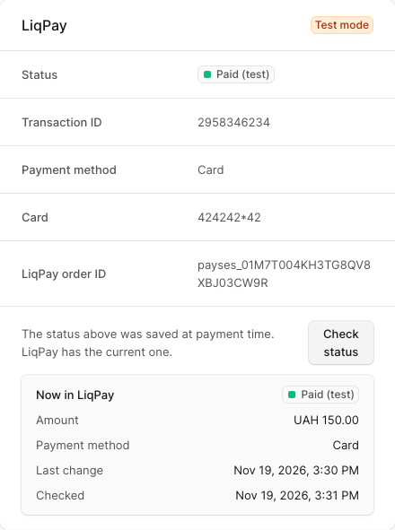
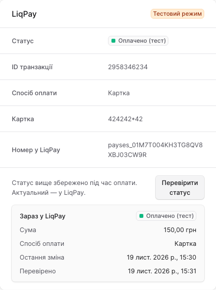
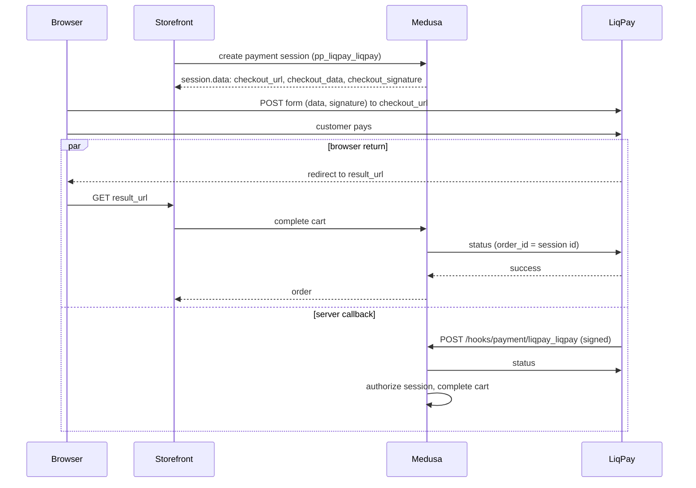

# medusa-plugin-liqpay

[LiqPay](https://www.liqpay.ua/) payments for [Medusa v2](https://medusajs.com). LiqPay is PrivatBank's payment gateway and one of the most widely used in Ukraine.

The customer pays on LiqPay's hosted checkout page (cards, Apple Pay, Google Pay, Privat24). Medusa creates the order from the browser return or from LiqPay's server callback, whichever arrives first, and always confirms the payment with LiqPay's API before creating it.

- **Payment provider** `pp_liqpay_<id>`: hosted checkout with `action: "pay"` (charged immediately), refunds from Admin, and a signed webhook on Medusa's built-in `/hooks/payment` route.
- **Store route** `GET /store/liqpay/carts/:id/status`: tells your return page whether a payment that did not complete the cart was declined, is still pending, or was never made.
- **Admin widget** on the order page: LiqPay transaction ID, payment method, masked card, and a live **Check status** button. English and Ukrainian.
- **Settings → LiqPay** in Admin: replaced checkout attempts where LiqPay shows money may have moved, with **Mark reviewed**, and refunds with an unknown outcome.
- **Safety ledger** in Medusa's database, created by `npx medusa db:migrate`: crash-safe refunds and late-payment tracking, with a scheduled job that rechecks replaced attempts.

| Medusa Admin, English | Medusa Admin, Ukrainian |
|---|---|
|  |  |

## Compatibility

| | |
|---|---|
| Medusa | 2.22.x (tested on 2.22.7) |
| Node.js | 22.22 or later (the same as Medusa 2.22) |
| Currency | UAH tested end to end. LiqPay also accepts USD and EUR. |

> The npm package [`medusa-payment-liqpay`](https://www.npmjs.com/package/medusa-payment-liqpay) is a different project, written for Medusa v1.

## Install

```bash
npm install medusa-plugin-liqpay
```

## Configure

The plugin has two parts, and both get the same merchant keys:

- the **plugin** entry, which loads the safety ledger and its migrations, the routes, the recheck job and the Admin pages;
- the **payment provider**, registered with Medusa's Payment Module.

```ts
// medusa-config.ts
import { defineConfig, loadEnv } from "@medusajs/framework/utils"

loadEnv(process.env.NODE_ENV || "development", process.cwd())

const liqpay = {
  public_key: process.env.LIQPAY_PUBLIC_KEY!,
  private_key: process.env.LIQPAY_PRIVATE_KEY!,
}

module.exports = defineConfig({
  projectConfig: { /* ... */ },
  plugins: [{ resolve: "medusa-plugin-liqpay", options: liqpay }],
  modules: [
    {
      resolve: "@medusajs/medusa/payment",
      options: {
        providers: [
          {
            resolve: "medusa-plugin-liqpay/providers/liqpay",
            id: "liqpay", // provider id: pp_liqpay_liqpay
            options: {
              ...liqpay,
              // Where LiqPay sends the customer back (your storefront):
              result_url: "https://shop.example.com/ua/checkout/liqpay/return",
              // Where LiqPay posts the payment callback (your backend, publicly reachable):
              server_url: "https://api.example.com/hooks/payment/liqpay_liqpay",
              description: "Оплата замовлення", // optional, default "Order payment"
              language: "uk", // optional, "uk" | "en", default "uk"
            },
          },
        ],
      },
    },
  ],
})
```

```bash
# .env
LIQPAY_PUBLIC_KEY=sandbox_i00000000000
LIQPAY_PRIVATE_KEY=sandbox_...
```

Then create the safety ledger tables in Medusa's database:

```bash
npx medusa db:migrate
```

Sandbox mode follows the key: a public key starting with `sandbox_` is a LiqPay sandbox merchant, and only then does LiqPay's `sandbox` status count as paid. A live key can never accept a test payment, and there is no separate switch to get wrong.

The ledger shares Medusa's database connection, so every API and worker instance uses it automatically. If its tables are missing or the database is down, payment mutations fail closed. See [deployment and recovery](docs/payment-recovery.md).

Then, in Medusa Admin, go to **Settings → Regions → your region** and add the **LiqPay** payment provider (`pp_liqpay_liqpay`).

### Options

| Option | Where | Required | Notes |
|---|---|---|---|
| `public_key`, `private_key` | plugin and provider | yes | From the LiqPay merchant cabinet → API. |
| `status_concurrency` | plugin | no | Concurrent LiqPay status requests per process, 1–256. Default `16`. |
| `rate_limits` | plugin | no | Per-process limits per minute: `{ status_per_cart: 60, sessions_per_collection: 10, callbacks_per_ip: 300 }` (the defaults; set any subset). `false` turns them off when your gateway limits these routes. |
| `recheck_batch_size` | plugin | no | Replaced attempts rechecked per 15-minute run, 1–1000. Default `50`. |
| `result_url` | provider | yes | Absolute URL of your storefront's return page. |
| `server_url` | provider | yes | `https://<backend>/hooks/payment/liqpay_<id>`. It must be publicly reachable (use a tunnel such as `cloudflared` or `ngrok` locally). |
| `description` | provider | no | Shown on LiqPay's page. Default `"Order payment"`. |
| `language` | provider | no | `"uk"` or `"en"`, the language of LiqPay's page. Default `"uk"`. |

Both the plugin entry and the provider must get the same keys. The plugin entry is required: it creates the ledger tables, verifies callback signatures before Medusa queues them, rate-limits LiqPay routes and runs the recheck job.

## How it works



- **LiqPay's `order_id` is the Medusa payment session id.** Each new payment attempt needs a unique session. Reuse an outstanding attempt while its signed `amount` and `currency_code` still match the cart; do not replace it merely because the customer clicks again. When the cart total changes, Medusa deletes the session and the plugin retires it: a signed form cannot be revoked, so a late payment on a retired attempt is recorded in the safety ledger for review and never completes a cart.
- **The browser is never trusted.** Cart completion and the webhook both ask LiqPay's `status` API. A paid amount or currency that differs from the signed session is refused and logged for a refund.
- **Exactly one order.** Medusa locks the cart, so the return and the callback cannot both create an order. Whichever arrives second gets the existing order.
- **Charge, not hold.** `action: "pay"` settles immediately, so the session is `captured` when authorized. Capture verifies the live settled status again; unsupported holds are rejected.

### Status mapping

| LiqPay status | Session status | Webhook action |
|---|---|---|
| `success` (or `sandbox` on a `sandbox_` key) | `captured` | `SUCCESSFUL` |
| `sandbox` on a live key | `error` | `FAILED` |
| `failure`, `error` | `error` | `FAILED` |
| `hold_wait` | `error` (unsupported hold) | not supported |
| `reversed` | `canceled` | not supported (a refund you started) |
| `*_verify` (3-D Secure, OTP, …) | `requires_more` | `REQUIRES_MORE` |
| anything else, or no payment yet | `pending` | `PENDING` |

## Storefront integration

[`examples/nextjs-starter`](examples/nextjs-starter) has drop-in files for the [Medusa Next.js Starter](https://github.com/medusajs/nextjs-starter-medusa). The flow takes three steps.

**1. Start a payment.** Create a LiqPay payment session. Its `data` holds a ready-signed form:

```ts
const { payment_collection } = await sdk.store.payment.initiatePaymentSession(
  cart,
  { provider_id: "pp_liqpay_liqpay" }
)
const session = payment_collection.payment_sessions!.find(
  (s) => s.provider_id === "pp_liqpay_liqpay"
)!
const { checkout_url, checkout_data, checkout_signature } = session.data
```

**2. Send the customer to LiqPay.** Post a form with the two fields to the URL:

```html
<form method="POST" action="{checkout_url}" accept-charset="utf-8" rel="noreferrer">
  <input type="hidden" name="data" value="{checkout_data}" />
  <input type="hidden" name="signature" value="{checkout_signature}" />
</form>
```

Send no referrer (`rel="noreferrer"` and `<meta name="referrer" content="no-referrer">` on the checkout page). LiqPay's firewall blocks browsers whose liqpay.ua cookies contain `localhost`, so after one checkout from `http://localhost` the hosted page loads blank. A browser that is already affected needs its liqpay.ua cookies cleared.

**3. Handle the return** at `result_url`. Complete the cart. If completion fails, ask the plugin what happened:

```ts
try {
  const result = await sdk.store.cart.complete(cartId)
  if (result.type === "order") return redirect(`/order/${result.order.id}/confirmed`)
} catch {}

const { outcome } = await sdk.client.fetch<{ outcome: string; completed: boolean }>(
  `/store/liqpay/carts/${cartId}/status`
)
```

| `outcome` | Meaning | Suggested UI |
|---|---|---|
| `paid` | LiqPay settled it; completing again will succeed (or the callback already did). | Pending page that retries the return route |
| `pending` | Still processing, or waiting for the customer (3-D Secure). | Pending page that retries |
| `failed` | Confirmed payment failure or reversal. | Back to the payment step with an error |
| `needs_review` | Paid amount/currency mismatch or unsupported hold. | Show support guidance; do not invite another payment |
| `not_paid` | LiqPay has no payment for this attempt; the customer left before paying. | Back to the payment step |
| `none` | The cart has no LiqPay session. | Back to the payment step |

LiqPay may return the customer with a form POST. Answer it with a `303` redirect to the same URL, so the browser follows up with a GET that carries your `SameSite=Lax` cart cookie (see the example route).

## API

### `GET /store/liqpay/carts/:id/status`

Needs a publishable API key, like every `/store` route. Returns `{ outcome, completed }` for the cart's newest LiqPay session and nothing else, so no payment details leave the server. Answers `404` for an unknown cart. Status lookups coalesce concurrent requests, cache results for five seconds and run at most `status_concurrency` (default 16) at once per process; beyond that the route answers `503` with `Retry-After: 1`. Middleware also limits requests per cart, and LiqPay payment session creation (`POST /store/payment-collections/:id/payment-sessions`) per payment collection (see `rate_limits`). These limits are never per shopper IP: a storefront server sends every shopper's requests from one address. Add cluster-wide gateway limits in production.

### `GET /admin/liqpay/payments/:id/status`

Admin-authenticated. Returns `{ liqpay_status }` with LiqPay's live state of a Medusa payment, as named fields: `found`, `status`, `payment_id`, `transaction_id`, `paytype`, `sender_card_mask2`, `amount`, `currency`, `create_date`, `end_date`, `err_code`, `err_description`, `checked_at`. The raw payload is not passed through. This route powers the widget's **Check status** button. Answers `503` when the status limit is reached.

### `GET /admin/liqpay/reviews`

Admin-authenticated. Returns `{ attempts, refunds }`: replaced checkout attempts flagged for review (signed amount, LiqPay's last status, when it was replaced) and refunds whose outcome is unknown. Powers **Settings → LiqPay**.

### `POST /admin/liqpay/attempts/:session_id/review`

Admin-authenticated. Body `{ note }` (1–1000 characters). Clears an attempt's review flag and records the admin user, the note and the time. A later payment on the attempt flags it again.

### Workflows and helpers

```ts
import {
  getCartLiqpayOutcomeWorkflow,
  getLiqpayLiveStatusWorkflow,
  markLiqpayAttemptReviewedWorkflow,
} from "medusa-plugin-liqpay/workflows"

import {
  LiqPayClient, // envelope(), verify(), request()
  signData,
  verifySignature,
  toSessionStatus,
  toCheckoutOutcome,
  type LiqPaySessionData,
} from "medusa-plugin-liqpay/lib"
```

### Payment session data

The provider stores flat, named fields, which you can read in the Store and Admin APIs. They contain no secret.

| Field | |
|---|---|
| `session_id` | Medusa payment session id; LiqPay's `order_id` |
| `checkout_url`, `checkout_data`, `checkout_signature` | The form to post to LiqPay |
| `amount`, `currency_code` | What was signed |
| `status` | `created`, then LiqPay's last known status |
| `is_sandbox` | Whether the session was created in sandbox mode |
| `transaction_id`, `liqpay_payment_id`, `liqpay_order_id` | Set once paid |
| `paytype`, `sender_card_mask2` | Payment method and masked card |
| `err_code`, `err_description` | LiqPay error, or `amount_mismatch` |
| `refunded_amount` | Total refunded through Medusa |

## Security notes

- The signature is compared in constant time and checked before the callback is decoded. Plugin middleware also rejects invalid signatures before queue admission. A forged callback returns `FAILED`, and Medusa stops it before any workflow runs.
- A paid status alone is not enough: amount and currency must match the signed session (half-kopiyka tolerance).
- Sandbox mode with a live key is refused at start-up.
- `initiatePayment` clears every payment field in the session data, so a shopper cannot plant values such as `transaction_id` through the Store API.
- LiqPay API calls time out after 15 s (refunds after 30 s), bounding the time a gateway request can hold a cart lock.
- **Refunds have no idempotency key on LiqPay's side.** If a refund gets no answer, the plugin does not know whether it went through. The durable ledger blocks retries and further refunds on the same payment until an operator reconciles the uncertain operation (**Settings → LiqPay** lists them). Successful operations replay using the same idempotency key without another upstream refund; a refund LiqPay confirmed failed can be retried. See [recovery instructions](docs/payment-recovery.md).
- **A signed checkout form cannot be revoked.** When the cart changes, Medusa deletes the old payment session and the plugin retires it in the ledger. A late payment on a retired attempt never completes a cart: it is flagged in **Settings → LiqPay** for a refund or a manual recovery. Callbacks flag it at once, and a scheduled job (every 15 minutes) asks LiqPay about retired attempts in case a callback was lost. The wait between checks doubles with the attempt's age (1 h, 2 h, 4 h, …, at most 7 days), for 30 days.

## Sandbox notes

- **Sandbox payments cannot be refunded.** LiqPay answers `payment_err_status` («Невірний статус платежу»). The refund fails in Admin and nothing is recorded as refunded. Test refunds on a live merchant with a small real payment.
- **The sandbox cannot produce a decline.** Test cards that should decline are accepted as `sandbox`, and LiqPay's form rejects expired dates before sending anything. The failure path is covered by unit tests and simulated callbacks.
- Test card: `4242 4242 4242 4242`, any future expiry, any CVV.
- The webhook needs a public `server_url`. Locally, expose port 9000 through a tunnel and set `server_url` to the tunnel URL.

## Limitations

- One LiqPay merchant per Medusa instance: the store route and widget use the keys from the `plugins` entry.
- No hold-then-capture flow (`action: "hold"`), subscriptions, or saved cards. Unexpected held payments are rejected.
- A late payment on a replaced checkout attempt is flagged for review, not attached to the changed cart automatically: prices, items and stock may have changed.
- No fiscal receipts (ПРРО). If your business needs them, send them from a subscriber on `payment.captured`, for example to Checkbox.

## Development

```bash
npm install
npm test           # unit tests (DB safety tests require LIQPAY_TEST_DATABASE_URL)
npm run typecheck
npm run build      # medusa plugin:build
```

[CONTRIBUTING.md](CONTRIBUTING.md) explains how to run the end-to-end suite against a local Medusa app and the LiqPay sandbox.

## License

[MIT](LICENSE)
